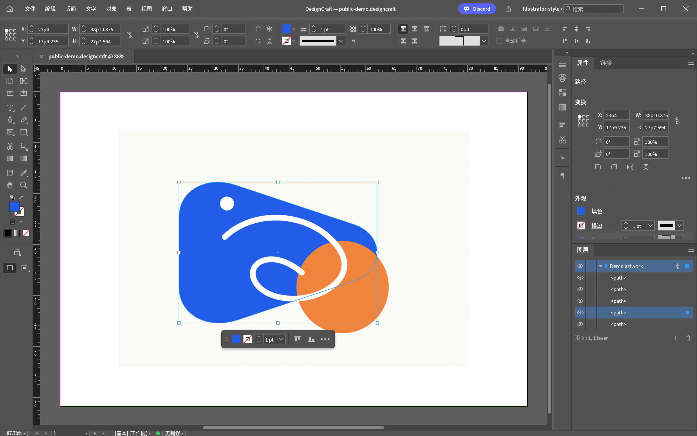

# Illustrator-style for DesignCraft

A native workspace and keyboard preset for people who prefer Illustrator-style habits while using DesignCraft.

[中文说明](README.md) · [Download](../../releases/latest)



## Included

- Two-column Tools panel and the top Control bar.
- Persistent Properties and Layers panels, with drawing panels in the adjacent icon dock.
- Illustrator-style shortcuts for Lock, Unlock All, Transform Again, Join, Place and drawing panels.
- Merge installation, an automatic full backup, and a restore script.
- Existing workspaces, shortcut sets, user scripts and unrelated preferences are preserved.

**Tested with DesignCraft 0.17.2 on Windows 11.** The scripts support Windows PowerShell 5.1 and PowerShell 7. Other DesignCraft versions and platforms are unverified.

## Install

Install [DesignCraft](https://getartcraft.com/apps/designcraft), download and extract a release, close DesignCraft normally, then run from the extracted directory:

```powershell
powershell -NoProfile -ExecutionPolicy Bypass -File .\Install.ps1
```

The execution-policy argument applies only to that process. No administrator access, downloads or process termination are used. The installer prints a backup path. Keep it for restoring your previous settings.

The workspace and shortcut set are both named **Illustrator-style**. The current interface language is preserved. Optional switches:

```powershell
.\Install.ps1 -Language zh
.\Install.ps1 -Language en
.\Install.ps1 -LayoutOnly
.\Install.ps1 -ConfigPath 'D:\Apps\DesignCraftData\ui.json'
.\Install.ps1 -WhatIf
```

The normal Windows settings path is `%APPDATA%\DesignCraft\ui.json`.

## Restore

Close DesignCraft, then use the backup path printed during installation:

```powershell
powershell -NoProfile -ExecutionPolicy Bypass -File .\Restore.ps1 -BackupPath 'FULL-PATH-TO-BACKUP'
```

Restore reproduces the complete saved UI configuration, including its original formatting. It also rolls back UI changes made after that backup. Your artwork files are unaffected.

## Important differences

This is a configuration preset, not a replacement drawing engine. It does not add Shape Builder, mesh gradients or a full Appearance stack. The Page tool remains a page tool, and DesignCraft's `D` shortcut still means no fill with a black stroke. B, O and U are cleared because their publishing-tool meanings differ from Illustrator.

**Illustrator's Ctrl+Y Outline mode is unavailable in DesignCraft 0.17.2.** Ctrl+H displays frame edges while retaining fills; it is not a pure outline view. Use the Layers panel to select obscured objects, or temporarily hide objects above them.

Common changes: **Ctrl+2** Lock; **Ctrl+Alt+2** Unlock All; **Ctrl+D** Transform Again; **Ctrl+J** Join; **Ctrl+Shift+P** Place; **Ctrl+U** Smart Guides; **Shift+O** Page tool. Existing matching defaults such as V/A/P, F6/F7 and Shift+F7 are retained. See the [full table](README.md#快捷键).

## Tests

```powershell
powershell -NoProfile -ExecutionPolicy Bypass -File .\tests\Test-Theme.ps1
```

Tests cover unrelated preferences, existing workspaces, shortcut conflicts, idempotence, language selection, exact backup/restore and malformed-backup rejection. They use a temporary directory, not your real configuration.

## Credits and license

Built with [DesignCraft's native configuration](https://github.com/storytold/designcraft/blob/main/docs/control-protocol.md). Shortcut reference: [Adobe's published defaults](https://helpx.adobe.com/illustrator/using/default-keyboard-shortcuts.html).

MIT License. An independent community preset, unaffiliated with Adobe or ArtCraft. Product names describe the intended compatibility and workflow.
