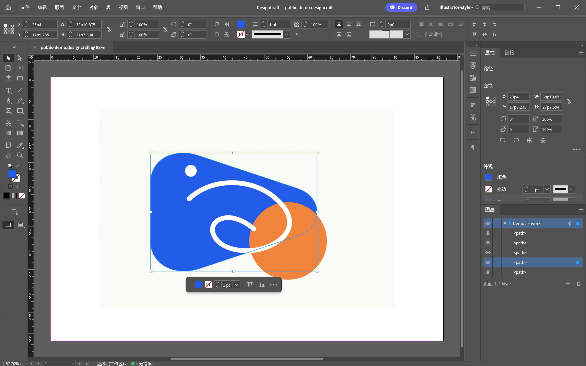

# Illustrator-style for DesignCraft

把 DesignCraft 的工作区和常用快捷键调整为更熟悉的 Illustrator 使用习惯。

[English](README.en.md) · [下载主题包](../../releases/latest) · [DesignCraft](https://github.com/storytold/designcraft)



这是 **DesignCraft 的工作区与快捷键预设**，使用软件原生配置，无需修改程序。它包含中文安装说明、备份与恢复脚本，以及可单独使用的布局预设。

## 有哪些调整

- 左侧双列工具栏、顶部控制栏。
- 右侧常驻属性和图层，旁边收纳颜色、色板、描边、渐变、对齐与路径查找器。
- 减少常驻排版面板，为矢量绘图留出画布。
- 调整锁定、连接路径、再次变换、置入文件等快捷键。
- 安装时合并设置，保留其他工作区、原快捷键集、脚本和无关偏好，并自动保存完整备份。
- 默认保留界面语言；可选择简体中文或英文。

## 安装

**已验证：DesignCraft 0.17.2、Windows 11。** 安装与恢复脚本支持 PowerShell 5.1 / 7。其他 DesignCraft 版本及 macOS / Linux 尚未验证。

1. 安装 [DesignCraft 官方版本](https://getartcraft.com/apps/designcraft)。
2. 下载 [Release ZIP](../../releases/latest) 并解压。
3. 正常关闭 DesignCraft，在解压目录打开 PowerShell。
4. 运行：

```powershell
powershell -NoProfile -ExecutionPolicy Bypass -File .\Install.ps1
```

该参数只用于本次脚本进程，不修改系统执行策略。脚本不需要管理员权限，不下载内容，不结束 DesignCraft 进程。

重新打开 DesignCraft，即可使用 **Illustrator-style** 工作区和快捷键集。安装脚本会输出备份文件位置，请保留该文件。

可选参数：

```powershell
# 同时将界面设为简体中文
.\Install.ps1 -Language zh

# 只安装布局，保留当前快捷键
.\Install.ps1 -LayoutOnly

# 便携版或其他设置目录
.\Install.ps1 -ConfigPath 'D:\Apps\DesignCraftData\ui.json'

# 仅预览要执行的文件修改
.\Install.ps1 -WhatIf
```

默认设置文件：`%APPDATA%\DesignCraft\ui.json`。本项目仅安装配置；不包含 DesignCraft 可执行程序、字体或 Adobe 资源。

## 快捷键

以下使用 Windows 的 Ctrl 表示。配置 JSON 中的 `Cmd` 是 DesignCraft 的跨平台表示。

| 操作 | 快捷键 |
|---|---|
| 选择 / 直接选择 | V / A |
| 钢笔 / 铅笔 | P / N |
| 矩形 / 椭圆 | M / L |
| 文字 / 渐变 / 吸管 | T / G / I |
| 旋转 / 缩放 / 自由变换 | R / S / E |
| 抓手 / 缩放视图 | H / Z |
| 锁定 / 全部解锁 | Ctrl+2 / Ctrl+Alt+2 |
| 再次变换 | Ctrl+D |
| 连接路径 | Ctrl+J |
| 置入文件 | Ctrl+Shift+P |
| 编组 / 取消编组 | Ctrl+G / Ctrl+Shift+G |
| 前移 / 后移 | Ctrl+] / Ctrl+[ |
| 置顶 / 置底 | Ctrl+Shift+] / Ctrl+Shift+[ |
| 颜色 / 图层面板 | F6 / F7 |
| 渐变 / 描边面板 | Ctrl+F9 / Ctrl+F10 |
| 对齐 / 路径查找器面板 | Shift+F7 / Ctrl+Shift+F9 |
| 智能参考线 | Ctrl+U |
| 页面工具 | Shift+O |

已有相同默认键位的命令不会被重复覆盖。B、O、U 原先对应内容收集、倾斜和间隙工具；主题会取消这些容易产生误操作的绑定。

## 恢复

正常关闭 DesignCraft，然后将安装脚本输出的备份文件传给恢复脚本：

```powershell
powershell -NoProfile -ExecutionPolicy Bypass -File .\Restore.ps1 -BackupPath '备份文件的完整路径'
```

恢复会还原备份时的完整界面配置，也会覆盖安装后对界面设置的修改。产品文档不受影响。首次安装前若没有配置文件，备份内容为 `{}`，恢复后使用 DesignCraft 默认设置。

## 功能边界

DesignCraft 的核心是页面排版，本预设没有增加 Illustrator 的功能。页面工具仍然编辑页面；它只是与画板编辑相近的入口。形状生成器、网格渐变、完整外观堆栈等功能不会因安装预设而出现。

`D` 仍沿用 DesignCraft 默认的“无填色、黑描边”，与 Illustrator 的默认白填色有差别。界面中的菜单结构、工具顺序和部分操作仍由 DesignCraft 决定。

**没有 Illustrator 的 Ctrl+Y 轮廓模式。** 已核对 0.17.2 的运行中命令列表；`Ctrl+H` 只能显示框架边缘，填色仍然存在，不能替代纯轮廓视图。选择被遮挡对象时，可使用图层面板展开条目定位，或暂时隐藏上方对象。

## 文件与测试

```text
theme/illustrator-style.json   仅主题所需的配置、工作区与键位
Install.ps1                   合并安装和自动备份
Restore.ps1                   从备份恢复
scripts/Theme.psm1            合并、文件写入及恢复逻辑
tests/Test-Theme.ps1          偏好保留、冲突处理、重复安装及恢复检查
docs/preview.png              使用独立示例文档生成的界面预览
```

```powershell
powershell -NoProfile -ExecutionPolicy Bypass -File .\tests\Test-Theme.ps1
```

测试只写入临时目录，不接触真实用户配置。

## 参考与许可

- [DesignCraft 原生工作区和控制协议](https://github.com/storytold/designcraft/blob/main/docs/control-protocol.md)
- [Adobe Illustrator 默认快捷键](https://helpx.adobe.com/illustrator/using/default-keyboard-shortcuts.html)
- [VectorCraft：同作者的矢量编辑项目](https://github.com/storytold/vectorcraft)

MIT License。本项目是独立的社区预设，与 Adobe 或 ArtCraft 无隶属关系；产品名称用于说明兼容对象与使用习惯。
